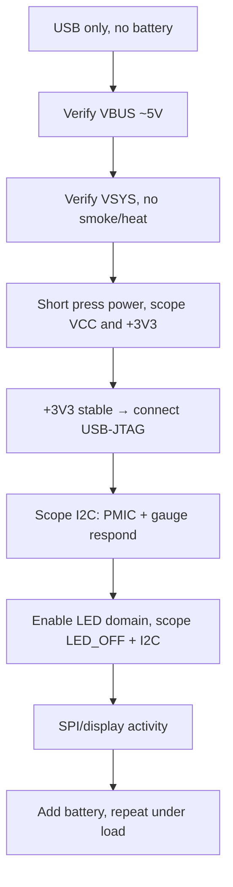

# Oscilloscope lesson plan — OWON HDS2102S + pdn-kit-hardware

Progressive hands-on curriculum for learning what an oscilloscope is for and how to use one, tied to the **pdn-kit-hardware** board (1S LiPo ESP32-S3 handheld: BQ25619 charger, TPS22917 load switch, TPS63802 buck-boost, IS31FL3236A LED drivers, SSD1315 OLED).

**Scope:** OWON HDS2102S — 100 MHz, 2 channels, 500 MS/s (single) / 250 MS/s (dual), 8-bit, built-in DMM and AWG.

**Project references** (external KiCad project, not in this repo):

- `~/projects/pdn-kit-hardware/design-context/design-decisions.md` — power topology and GPIO roles
- `~/projects/pdn-kit-hardware/design-context/system-map.md` — nets and GPIO map
- `~/projects/pdn-kit-hardware/review-exports/power.svg` — probe locations

---

## How this plan is organized

| Phase | Focus | pdn-kit tie-in |
|-------|--------|----------------|
| 0 | Setup and safety | Before touching the board |
| 1 | What scopes are for | When DMM vs scope |
| 2 | Controls and a known signal | Built-in AWG |
| 3 | DC rails and power states | VBUS → VSYS → VCC → +3V3 |
| 4 | Slow digital control | PWR_HOLD, INT, buttons |
| 5 | Serial buses | I2C to PMIC/gauge/LEDs; SPI to display |
| 6 | Switching and ripple | TPS63802, BQ25619, TPS22917 turn-on |
| 7 | First power-on playbook | Real bring-up sequence |

Each lesson is roughly 30–60 minutes. Do them in order; later lessons assume earlier skills.

---

## Phase 0 — Unbox, calibrate, and safety

**Goal:** Know your probe, grounds, and voltage limits before probing a live LiPo board.

### OWON setup checklist

1. Charge batteries; run **self-calibration** (menu → utility/calibration per manual).
2. Set probe menu to **10×** if using the included passive probe (almost certainly 10×).
3. Confirm coupling icon shows **DC** for rail work; **GND** clip goes to board **GND** only.
4. Know limits: **400 V max** at probe tip; on pdn-kit you will stay under 5 V except possibly VBUS spikes.

### pdn-kit safety rules

- Prefer **USB-powered bench bring-up** before relying on the pack.
- Use a **current-limited** USB supply or lab supply on VBUS if you have one.
- Never float the scope ground on a powered board — the OWON ground clip is tied to earth/USB ground.
- For LiPo work: have a fire-safe surface, know where PPTC/FET protection is (power sheet), and probe with **one hand** when possible.

**Success:** Stable trace on the AWG output (next lesson) with correct 10× scaling.

---

## Phase 1 — What an oscilloscope is for

**Goal:** Understand *when* to reach for the scope vs your DMM.

### Use a multimeter when

- Steady DC: “Is +3V3 actually 3.3 V?”
- Resistance, continuity, diode drops.

### Use a scope when

- Voltage **changes over time** (power-up, button press, charge start/stop).
- You need to see **shape**, not just average: ripple, overshoot, ringing, glitches.
- Digital signals: “Is I2C toggling?”, “Is SPI clock running?”, “Is INT pulsing?”
- **Two things at once** (dual channel): e.g. SCL vs SDA, or VSYS vs +3V3 during power-on.

### pdn-kit examples where a scope pays off

| Question | Tool | Where |
|----------|------|-------|
| Is +3V3 regulated? | DMM is enough if steady | +3V3 cap near U3/U6 |
| Does +3V3 **droop** when LEDs turn on? | Scope | +3V3 + trigger on LED activity |
| Did the load switch actually turn on? | Scope | VSYS vs VCC |
| Is the charger negotiating / charging? | Scope | VBUS, `/power/BAT_BQ`, INT |
| Are LED drivers on the I²C bus? | Scope | I2C_SCL / I2C_SDA |
| Is the buck-boost switching? | Scope (AC coupling) | U3 SW node or +3V3 ripple |

### Exercise

Write down three bugs you could *not* diagnose with a DMM alone on this board. Examples: TPS22917 soft-start too slow, I²C stuck low, BQ25619 INT stuck asserted.

---

## Phase 2 — Learn the OWON controls on a known signal

**Goal:** Volts/div, time/div, trigger, measure, and 10× math without the board.

**Hookup:** AWG out → scope CH1 (same BNC or a short wire). Start with **1 kHz sine, 1 Vpp**.

### Settings to internalize

| Control | Start here | What it does |
|---------|------------|--------------|
| Volts/div | 500 mV/div | Vertical scale; with 10× probe, OWON should show ~1 Vpp |
| Time/div | 500 µs/div | ~2 cycles of 1 kHz visible |
| Trigger | Auto, rising edge, ~0 V | Stabilizes the waveform |
| Coupling | DC | Shows absolute voltage |
| Probe | 10× | Must match physical probe switch |

### Drills

1. Change time/div until one full sine cycle fills the screen.
2. Switch to **square wave** — notice rise time.
3. Turn on built-in **Vpp / Freq** measurements.
4. Enable **20 MHz bandwidth limit** — see noise reduction (useful later on +3V3).

**Success:** You can predict what happens when you halve time/div or double volts/div.

---

## Phase 3 — DC power tree on pdn-kit

**Goal:** Read the power topology and verify each rail in the right order.

Power path (from pdn-kit design decisions):

```
USB VBUS ─┐
          ├─ BQ25619 ─ VSYS ─ TPS22917 ─ VCC ─┬─ LED drivers / OLED pump
LiPo +BATT┘                                    └─ TPS63802 ─ +3V3 ─ ESP32 / logic
```

### Lesson 3A — Static rails (board off / USB only)

Probe points (use `review-exports/power.svg` to find test-friendly caps):

| Net | Expected (approx) | Probe | OWON |
|-----|-------------------|-------|------|
| **VBUS** | 5 V USB | USB-C side cap | 1 V/div, DC, 10× |
| **VSYS** | ~3.7–4.2 V (battery) or ~4.5 V (USB) | U1 SYS cap | same |
| **VCC** | 0 V if switch off | U2 VOUT | same |
| **+3V3** | 0 V if switch off | U3 VOUT or U6 pin 2 | 500 mV/div |

Compare every scope reading to the **DMM** — they should agree on DC. If not, check probe attenuation.

### Lesson 3B — Power-on sequence (dual channel)

| CH1 | CH2 | Trigger | What you learn |
|-----|-----|---------|----------------|
| **VCC** | **+3V3** | Rising edge on VCC | Load switch then regulator sequence |
| **VSYS** | **VCC** | VCC | How much VSYS sags at turn-on |
| **PWR_HOLD** (IO4) | **VCC** | VCC | Firmware latch vs rail enable |

From the design: short press drives **PWR_HOLD** high → TPS22917 **ON** → **VCC** rises → TPS63802 enables → **+3V3** comes up.

**OWON settings:** 500 ms/div to 2 s/div for human button timing; DC coupling; trigger on VCC crossing ~1 V.

**Success criteria:**

- VCC monotonic rise (no oscillation).
- +3V3 follows VCC by tens of ms (soft-start + regulator start).
- +3V3 within **3.15–3.45 V** under light load.

**Common mistakes:** Probing before GND clipped; probing mid-trace instead of at a cap; forgetting the switch kills **+3V3** entirely when off (by design).

---

## Phase 4 — Slow digital signals and user interaction

**Goal:** Trigger on edges and measure pulse width — firmware-visible GPIO.

### Lesson 4A — Buttons and power GPIO

| Signal | GPIO | What to look for |
|--------|------|------------------|
| **PWR_OFF** | IO5 | Pulse width on long press (~30 s factory reset policy) |
| **PWR_HOLD** | IO4 | Latches high after short press |
| **INT** (BQ25619) | IO7 | Open-drain pulses; 10 kΩ pull-up to +3V3 |
| **MAX_ALRT** | IO8 | Gauge alerts (100 kΩ pull-up) |

**OWON:** 100 ms/div – 1 s/div; trigger CH1 falling/rising on button net; measure pulse width.

### Lesson 4B — LED_OFF (IO13)

When **LED_OFF** / SDB goes high, LED driver **VCC** domain should already be up. Scope **LED_OFF** and a representative LED anode or driver VCC pin.

### Lesson 4C — Vibration motor (UI sheet)

Probe **VIB_MOTOR** (IO17) and motor drive transistor output. Expect PWM bursts, not clean squares (motor + transistor slewing). Compare **frequency** and **duty** to what firmware intended.

**Success:** Capture a single button press with **single trigger** mode and explain the timing.

---

## Phase 5 — Buses: I²C and SPI

**Goal:** Confirm communication before trusting firmware logs.

### Lesson 5A — I²C

Shared bus: BQ25619, MAX17260, IS31FL3236A ×2.

Nets: **I2C_SCL** (IO2), **I2C_SDA** (IO1). Pull-ups: ~2.35 kΩ effective (split 4.7 kΩ at power + brain).

**OWON dual-channel setup:**

- CH1 = SCL, CH2 = SDA
- **2 µs/div** (400 kHz fast mode bit ≈ 2.5 µs)
- Trigger: SCL falling edge
- Threshold ~1.5 V (3.3 V logic)

**What good looks like:** Clean 0–3.3 V squares; SDA changes only when SCL is low (except START/STOP).

**What bad looks like:** SDA or SCL stuck at 0 V; rounded edges (missing pull-ups); no activity (EN/clock gating, switch off).

### Lesson 5B — SPI to OLED

Nets: **SCLK**, **SDIN**, **CS**, **DC** (brain ↔ ui hierarchy).

Start slower: **10–20 µs/div** if clock is modest; increase until edges blur — that tells you your effective bandwidth limit.

Trigger on **CS** falling edge to frame one transaction.

**Success:** Identify an I²C START condition and count ~9 clock pulses for an address byte.

---

## Phase 6 — Switching, ripple, and charging

**Goal:** Use AC coupling and bandwidth limit to see small AC on top of DC rails.

### Lesson 6A — TPS63802 ripple on +3V3

- CH1: **+3V3** at U3 output cap
- Coupling: **AC** (or DC with offset)
- Volts/div: **10–50 mV/div**
- Time/div: **500 ns – 2 µs/div** (adjust until you see periodic ripple)
- Optional: **20 MHz BW limit** to reduce junk

Compare **light load** vs **Wi-Fi transmit** or LED load.

### Lesson 6B — TPS22917 turn-on / inrush

Design notes ~700 mA worst-case inrush when **VCC** dumps into LED/display input caps.

- CH1: **VCC**, CH2: **VSYS**
- Time/div: **1–10 ms/div**
- Look for VSYS dip at switch-on; if excessive, note it for bulk cap / soft-start review.

### Lesson 6C — USB insert and charging (BQ25619)

With USB connected, scope:

- **VBUS**
- **INT** or `/power/BAT_BQ` behavior
- Time/div: **1–5 s/div** for charge state changes

Cross-check with DMM on battery node when safe. INT should be **open-drain pulses**, not a stuck level.

### Lesson 6D — USB D+/D- (optional)

ESP32 native USB-JTAG on **IO19/IO20** through **USBLC6**. Full-speed eye patterns are hard on a 2-ch scope, but you can still see **activity** during enumerate/flash.

**Success:** Measure ripple **mVpp** on +3V3 and describe whether it worsens under load.

---

## Phase 7 — First power-on playbook

**Goal:** Combine everything into an ordered bring-up — first power-on → firmware → power/LED debug.

### Recommended sequence



### Capture list (save screenshots on the OWON)

1. Power-on: VSYS, VCC, +3V3
2. I²C traffic after firmware boot
3. +3V3 ripple at idle vs LED PWM on
4. BQ25619 INT during plug-in

### Stop conditions (power off immediately)

- +3V3 > 3.6 V sustained or < 3.0 V under light load
- VSYS or VCC oscillating (switching between states)
- Any rail drawing unexpected current (feel U1/U3/U2 — warm is bad at idle)
- I²C lines stuck at 0 V

---

## OWON HDS2102S cheat sheet for pdn-kit

| Measurement | Probe | Coupling | Time/div | Volts/div | Channels |
|-------------|-------|----------|----------|-----------|----------|
| Rail DC | 10× | DC | 100 ms+ | 1 V | 1 |
| Power sequence | 10× | DC | 500 ms | 1 V | VCC + +3V3 |
| I²C | 10× | DC | 2 µs | 1 V | SCL + SDA |
| SPI | 10× | DC | 10 µs | 1 V | SCLK + CS |
| Regulator ripple | 10× | AC | 1 µs | 20 mV | 1 |
| Button timing | 10× | DC | 100 ms | 2 V | 1 |

### Handheld-specific tips

- Short ground lead — spring clip at probe base, not 6" wire (matters for ripple/USB).
- Dual channel costs **half** sample rate (250 MS/s) — fine for this board.
- 8-bit resolution: set volts/div so the signal uses a large fraction of screen height.
- Built-in DMM mode is fine for confirming DC before switching to scope mode on the same probe.

---

## Suggested schedule

| Week | Lesson | Board state |
|------|--------|-------------|
| 1 | Phase 0–2 | AWG only |
| 2 | Phase 3A–3B | USB power, no firmware required for rail checks |
| 3 | Phase 4 | Power button + GPIO |
| 4 | Phase 5 | Firmware boot, I²C/SPI |
| 5 | Phase 6 | Loaded board, LED + ripple |
| 6 | Phase 7 | Full capstone + documented captures |

---

## What to skip early

- Trying to “decode” I²C packet contents on the scope — use firmware logs or a logic analyzer later; the scope confirms *activity* and *stuck buses*.
- High-speed USB eye diagrams — not the right tool on a handheld 8-bit scope.
- Probing **SW** nodes before you’re comfortable with grounding and AC coupling — start at **output caps**.
